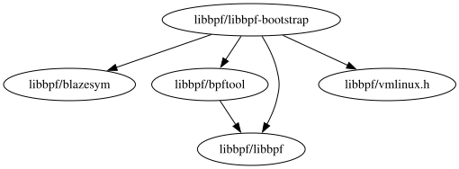
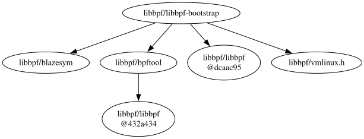

# toggysmith/gse

`gse` (Git Submodule Explorer) is a small utility for exploring Git submodule graphs.

## Usage

Generate a `graph.json` file describing the Git submodule graph:

```console
gse explore [-d,--maxdepth] [-p,--path]
```

Convert a `graph.json` file into a `graph.dot` file:

```console
gse transform [-s,--src] [-f,--fmt] [-d,--dst]
```

For example:

```console
gse transform --src ./graph.json --fmt dot --dst graph.dot
```

## Caveats

At the moment, gse will not show if there are different versions of submodules in the graph.

For example, running this on `libbpf/libbpf-bootstrap` produced this:



However, `libbpf/libbpf-bootstrap` and `libbpf/bpftool` submodule (at the time of writing) different commits of `libbpf/libbpf`. Therefore, a more accurate version of the graph would be:


